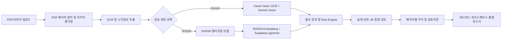

# Ai ENG Agent 프로젝트 발표자료

## 1. 프로젝트 한 줄 소개

Ai ENG Agent는 건축·토목·기계·전기·소방 도면(PDF/이미지)을 업로드하면 도면 이미지와 OCR 정보를 분석하고, 국내 법규·기술기준·사내 기준을 근거로 설계·안전·원가절감(VE) 검토의견을 생성하는 웹 기반 엔지니어링 검토 플랫폼이다.

핵심 방향은 단순한 AI 질의응답이 아니라 **실제 도면 증거 + 법규 근거 + 수치 규칙 + 전문가 검토 형식**을 하나의 검토 흐름으로 연결하는 것이다.

---

## 2. 문제 정의

### 2.1 해결하고자 한 업무

기존 도면 검토는 PDF를 열고, 여러 분야 도면과 법규를 수작업으로 대조하며, 검토의견·근거·조치사항을 별도로 정리해야 했다. 특히 다음 문제가 반복되었다.

- 다중 페이지 PDF의 도면 내용을 페이지별로 확인하기 어려움
- OCR 텍스트만으로는 기호, 배치, 이격거리, 배관·헤드 위치를 충분히 판단하기 어려움
- 검토자의 경험에 따라 법규 검색 범위와 의견 수준이 달라짐
- 설계오류, 안전, 시공 전·후 확인사항, 타 분야 인터페이스, VE 의견이 한 문서에 체계적으로 분리되지 않음
- AI가 도면과 무관한 예시 의견을 생성하거나, 확인하지 못한 값을 추정하는 위험이 있음
- 검토의견과 도면 주석의 위치·번호·페이지가 일치하지 않으면 검토 결과를 다시 대조해야 함

### 2.2 문제가 중요한 이유

도면 검토에서 작은 누락도 재설계, 재시공, 인허가 보완, 공사비 증가로 이어질 수 있다. 예를 들어 소방 도면에서 기존 배관 재사용 범위, 헤드 간격, 전기실·발전기실의 소화설비 적용, 펌프·수원 여유가 명확하지 않으면 착공 후 설계변경과 공정 지연이 발생할 수 있다.

따라서 이 프로젝트는 ‘AI가 의견을 많이 쓰는가’보다 다음을 핵심 품질 기준으로 설정했다.

1. 의견이 실제 도면의 특정 페이지·위치·텍스트·기호에 연결되는가
2. 적용 법규 조항이 의견마다 명확한가
3. 수치 검토를 LLM의 추정에만 맡기지 않는가
4. 확인 불가 항목을 임의로 양호 또는 오류로 단정하지 않는가
5. 검토 결과를 현업 검토자가 다시 확인할 수 있는가

### 2.3 문제를 바라본 가설

초기 가설은 “도면 이미지를 멀티모달 LLM에 전달하고 전문 프롬프트를 작성하면 수준 높은 검토가 가능하다”였다.

구현 과정에서 이 가설만으로는 충분하지 않다는 것을 확인했다. 품질은 다음 네 요소의 결합으로 결정되었다.

```text
도면 시각정보
+ OCR/추출 텍스트
+ 관련 법규 검색
+ 수치 Rule Engine
+ 구조화된 전문가 프롬프트
```

---

## 3. 서비스 개요 및 주요 기능

### 3.1 사용자 흐름



### 3.2 주요 기능

- PDF 및 이미지 도면 업로드
- 다중 페이지 PDF 페이지별 검토
- PDF 원본 이미지 미리보기 및 확대·축소·이동
- 도면 페이지별 주석 번호 및 색상 마킹
- 설계오류·안전·원가절감(VE) 분류
- 심각도별 검토의견 표시
- 검토근거와 증거 데이터 표시
- 법규 조항과 검토의견 연결
- 설계·안전·공사비/VE 대시보드
- 도면 워크스페이스에서 페이지·주석·상세의견 동기화
- 통합 보고서 출력
- AI 설계 도우미 챗봇
- 수계 소화설비 수치 계산 모듈

---

## 4. 전체 시스템 아키텍처

```text
React UI
  ├─ UploadView: 파일 업로드·엔진 선택
  ├─ DashboardView: 분야별 검토 요약
  ├─ ReviewWorkspaceModal: 도면·주석·검토의견 연계
  ├─ PdfViewerModal: PDF 페이지 미리보기
  ├─ ReportView: 통합 보고서
  └─ DesignErrors/Safety/CostVe View: 분야별 결과
          │
          ▼
API / Local Express Server
  ├─ PDF 페이지 처리
  ├─ Gemini/Vertex AI 호출
  ├─ NVIDIA 멀티모달·Embedding·Text LLM 호출
  ├─ 로컬 법규 검색
  ├─ Supabase pgvector 검색
  └─ Rule-based 수치 검증
          │
          ├─ Google Cloud Vision API
          ├─ Gemini Enterprise Agent Platform/Vertex AI ADC
          ├─ Gemini API fallback
          ├─ NVIDIA NIM API
          └─ Supabase PostgreSQL + pgvector
```

### 4.1 핵심 데이터 흐름

```text
파일
 → 페이지 이미지
 → OCR/도면 시각정보
 → 공종·키워드·수치 추출
 → 법규/기술기준 검색
 → Rule-based 1차 판정
 → 멀티모달/텍스트 LLM 종합판단
 → 구조화 JSON
 → UI 주석·리스트·보고서
```

---

## 5. 주요 활용 기술 및 도구

### 5.1 프론트엔드

- React 19: 컴포넌트 기반 UI 구성
- TypeScript 5.8: 검토 결과·도면·주석 데이터 타입 안정성 확보
- Vite 6: 개발 서버와 프로덕션 번들링
- Tailwind CSS 4 및 CSS: 대시보드·카드·패널·반응형 레이아웃
- lucide-react: 검토, 파일, 도면, 안전, VE 아이콘
- motion: 화면 전환과 인터랙션
- PDF.js: PDF 페이지 렌더링 및 도면 미리보기

### 5.2 백엔드 및 배포

- Node.js 24 실행환경
- Express 4: 로컬 API 서버와 업로드·검토 라우팅
- tsx: TypeScript 기반 개발 서버 실행
- Vercel Serverless Functions: 배포용 API 엔드포인트
- Vercel: 프론트엔드 및 API 배포
- esbuild: 서버 코드 번들링
- `maxDuration`, 업로드 body size 설정: 대용량 PDF 및 장시간 AI 요청 대응

### 5.3 Google AI 계열

- Google Gen AI SDK `@google/genai`
- Gemini 멀티모달 모델: PDF 페이지 이미지와 텍스트를 함께 전달
- Gemini Enterprise Agent Platform/Vertex AI: 로컬 환경에서 ADC 기반 호출
- Google Cloud Vision AI: `DOCUMENT_TEXT_DETECTION`, `TEXT_DETECTION` 기반 OCR 전처리
- Google Cloud Project 및 Vertex AI API
- ADC(Application Default Credentials): 로컬 gcloud 인증·서비스 계정 인증

현재 로컬 `server.ts`는 `VERTEX_AI_PROJECT_ID` 또는 `GOOGLE_CLOUD_PROJECT`가 있으면 Vertex AI 경로를 우선 선택한다. Vercel API는 별도 배포 인증 구성이 필요하므로, 배포 환경에서는 Vertex AI용 서비스 계정/WIF 또는 Cloud Run 분리 구성이 필요하다.

### 5.4 NVIDIA 계열

NVIDIA 엔진을 선택한 경우 다음 역할을 분리한다.

- 멀티모달 도면 추출: `nvidia/nemotron-3-nano-omni-30b-a3b-reasoning`
- 임베딩: `nvidia/nemotron-3-embed-1b`
- 텍스트 종합: `nvidia/nemotron-3-nano-30b-a3b`
- NVIDIA API: OpenAI 호환 `/chat/completions`, `/embeddings` 호출

역할 분리는 “도면 이미지 이해”, “법규 의미 검색”, “한국어 검토보고서 생성”을 한 모델에 모두 맡기지 않기 위한 설계이다.

### 5.5 법규 DB 및 RAG

- Supabase PostgreSQL
- pgvector 확장
- `engineering_rules` 컬렉션
- 법규 조항 임베딩 및 similarity 검색
- 공종(trade), 법규 코드(codeClause), severity, source metadata 저장
- NVIDIA 선택 시 NVIDIA Embedding → Supabase pgvector Top-K 검색
- 검색된 조항을 NVIDIA Text LLM의 컨텍스트로 주입

법규 데이터는 소방·건축·토목·기계·전기·산업안전 분야를 대상으로 구성하고, NFPC/NFTC, KDS/KCS/KEC, 건축·산업안전 관련 기준을 조항 단위로 관리하는 방향으로 확장했다.

### 5.6 Gemini의 로컬 법규 검색

Gemini 경로는 NVIDIA와 동일한 pgvector 검색을 사용하지 않고, 로컬 규칙 DB 기반 키워드 검색을 사용하도록 분리했다.

```text
도면/OCR 텍스트
 → 공종·키워드 추출
 → local rules DB keyword matching
 → 관련 법규 조항
 → Gemini 프롬프트 Context
```

이는 두 엔진의 검색 구조를 비교하고, 외부 벡터 DB 장애가 Gemini 경로에 직접 영향을 주지 않도록 하기 위한 선택이다.

### 5.7 Rule-based 엔진

- `src/services/ruleEngine.ts`
- 소화설비 수량·헤드 수·배관경·압력·이격거리·수치 조건 검토
- LLM 응답 전에 1차 사전 검증
- PASS / WARNING / CRITICAL / NEEDS_CONFIRMATION 분류
- 법규 DB의 `checkCondition`, `severity`, `code`를 이용한 검토

LLM은 도면 의미와 맥락을 해석하고, Rule Engine은 명확한 수치 조건을 검증하도록 역할을 분리했다.

---

## 6. 엔진별 검토 구조

### 6.1 Gemini/Vertex AI 경로

```text
PDF 페이지 이미지
 → Cloud Vision OCR
 → Gemini Vision/멀티모달 분석
 → local keyword rules 검색
 → Rule Engine
 → Gemini 구조화 JSON 생성
 → 설계·안전·VE 결과
```

장점은 국내 법규 DB와 한국어 검토 프롬프트를 빠르게 결합할 수 있다는 점이다. 단점은 키워드가 명확하지 않거나 법규 문맥이 복잡하면 검색 누락이 발생할 수 있다는 점이다.

### 6.2 NVIDIA 경로

```text
PDF 페이지 이미지
 → NVIDIA Vision 모델
 → NVIDIA Embedding으로 검토 질의 벡터화
 → Supabase pgvector Top-K 법규 검색
 → Rule Engine
 → NVIDIA Text LLM 종합 보고서
```

장점은 의미 기반 법규 검색과 모델별 역할 분리가 가능하다는 점이다. 단점은 멀티모달 모델 응답 지연, JSON 형식 불안정, 한국어 품질 편차, Embedding 차원·pgvector 인덱스 설정 문제를 함께 관리해야 한다는 점이다.

---

## 7. 교육 내용과의 연계

### 데이터·전처리

- PDF 페이지 분리와 이미지 렌더링
- OCR 텍스트와 도면 이미지의 결합
- 다중 페이지 데이터 구조화
- JSON 파싱 및 비정상 LLM 응답 보정

### 생성형 AI 및 멀티모달

- 이미지와 텍스트를 함께 전달하는 멀티모달 프롬프트
- 분야별 시스템 프롬프트
- 구조화 JSON 출력
- 확인 불가 값과 근거 없는 추론을 구분하는 프롬프트

### RAG

- 조항 단위 Chunking
- Embedding 생성
- Vector DB 적재
- Top-K similarity 검색
- 검색 근거를 LLM Context로 주입

### 소프트웨어 설계

- React 컴포넌트 분리
- API와 UI 역할 분리
- Gemini/NVIDIA provider 분기
- 로컬 개발환경과 Vercel 배포환경 분리
- 환경변수 기반 API 인증

### 선택 기술과 대안 검토

| 대상 | 선택 | 검토한 대안 | 선택 이유 |
|---|---|---|---|
| UI | React + Vite | Next.js | 기존 프로토타입과 빠른 UI 반복에 적합 |
| PDF | PDF.js | 서버 PDF 변환 | 브라우저에서 페이지별 미리보기·확대가 쉬움 |
| Gemini 인증 | Vertex AI ADC | Gemini API Key | Google Cloud 프로젝트·운영 인증과 연결 가능 |
| 법규 검색 | Gemini 로컬 키워드 / NVIDIA pgvector | 전체 DB 프롬프트 주입 | 비용·지연·검색 정확도 문제를 분리 비교 |
| 수치 검토 | Rule Engine 병행 | LLM 단독 판단 | 수치 오류와 환각을 줄임 |
| 배포 | Vercel | Cloud Run 단일 배포 | UI 배포와 빠른 프로토타입 검증에 유리 |

---

## 8. 시행착오와 학습점

### 8.1 단순 OCR 기반 검토의 한계

초기에는 OCR 텍스트를 중심으로 검토했다. 그러나 OCR은 도면의 공간관계, 헤드 배치, 배관 연결, 장애물 간섭을 충분히 표현하지 못했다. 이후 PDF 페이지를 이미지로 변환해 멀티모달 모델에 함께 전달하는 구조로 개선했다.

### 8.2 예시 데이터가 실제 검토처럼 출력되는 문제

초기 프론트엔드에 있던 샘플 검토의견과 AI 응답이 섞이면서, 업로드 도면과 무관한 문장이 표시되는 문제가 있었다. 이를 해결하기 위해 다음을 적용했다.

- 실제 업로드 페이지를 모델 입력으로 강제
- 근거 없는 값은 `확인 불가` 또는 `NEEDS_CONFIRMATION`
- 법규 근거와 도면 evidence 필드 분리
- provider와 modelUsed를 응답에 기록
- 설계·안전·VE 배열을 별도 관리

### 8.3 다중 페이지와 주석 불일치

전체 PDF의 주석 번호가 페이지별로 다시 시작되거나, 다른 페이지의 주석이 표시되는 문제가 있었다. 이후 주석에 `pageNumber`, `id`, `xPercent`, `yPercent`를 포함하고, 페이지 선택과 검토의견 선택을 함께 이동시키는 방향으로 개선했다.

### 8.4 NVIDIA RAG 장애와 품질 저하

NVIDIA 경로에서는 Embedding 차원과 pgvector 인덱스 차원 불일치, API 응답 지연, JSON 응답 형식 문제를 경험했다. 이를 통해 다음을 학습했다.

- 모델 변경 시 Embedding 차원과 DB 인덱스를 함께 검증해야 함
- 장시간 모델 호출에는 타임아웃·재시도·상태 표시가 필요함
- Vision 추출과 Text 종합을 분리해야 장애 원인 파악이 쉬움
- RAG가 연결되어 있어도 검색 결과를 실제 프롬프트에 주입하는지 별도 확인해야 함

### 8.5 Gemini와 NVIDIA의 인증·배포 차이

로컬에서는 Vertex AI ADC가 정상 작동하지만, Vercel은 로컬 ADC 파일을 자동으로 사용할 수 없다. 따라서 개발환경과 배포환경의 인증 경로를 분리하고, 향후 Cloud Run + 서비스 계정 또는 Workload Identity Federation 구성이 필요하다는 점을 확인했다.

---

## 9. 멘토링·코칭 피드백 반영

프로젝트 진행 중 반영한 핵심 피드백은 다음과 같다.

### 피드백 1: “업로드만 되고 실제 검토가 보이지 않는다”

- 업로드 상태와 검토 상태를 분리
- API 응답의 `engine`, `model`, `ragContext`, `ruleScreening` 표시
- 검토 완료 후 대시보드에 결과 반영

### 피드백 2: “도면이 안 보이고 주석만 보인다”

- PDF 원본을 페이지 이미지로 렌더링
- 도면과 주석을 동일 좌표계로 관리
- 페이지별 도면·주석 동기화
- 주석 클릭 시 관련 검토의견으로 연결

### 피드백 3: “검토의견이 장황하거나 샘플 데이터 같다”

- 설계·안전·VE 카테고리 분리
- 목록형 카드와 상세 패널로 표시
- evidence, codeClause, severity 필드 표준화
- 도면에서 확인되지 않은 내용은 확인 필요로 표시

### 피드백 4: “법규 근거가 불명확하다”

- 법규 코드와 조항 제목을 각 의견에 저장
- Gemini는 로컬 규칙 DB, NVIDIA는 pgvector RAG 사용
- Rule Engine 판정 결과를 최종 응답에 포함

### 피드백 5: “화면이 복잡하고 가독성이 낮다”

- 좌측 도면 목록 / 중앙 도면 / 우측 검토의견 3단 구조
- 심각도별 색상 체계
- 핵심검토항목 독립 스크롤 패널
- 도면 워크스페이스와 보고서 기능 통합
- 제목·카드·버튼·아이콘의 시각적 계층 개선

---

## 10. 현재 성과와 한계

### 성과

- PDF/이미지 도면 업로드부터 검토 결과 표시까지 단일 웹 흐름 구현
- 실제 도면 이미지 기반 멀티모달 검토 구조 구현
- 분야별 설계·안전·VE 검토 결과 분리
- 로컬 법규 DB와 Supabase pgvector RAG를 엔진별로 적용
- 수치 기반 Rule Engine 병행
- 도면 주석과 검토의견 연결 UI 구현
- Vertex AI ADC 로컬 인증 경로 구현
- Vercel 배포 및 운영 상태 확인 API 구현

### 한계

- 도면 품질과 해상도에 따라 OCR·기호 인식 편차가 존재
- 복잡한 도면의 위치 추정은 모델별 안정성 차이가 있음
- 법규 DB의 전체 원문·개정 이력·시행일 관리가 더 필요
- Vercel에서 Vertex AI ADC를 동일하게 사용하려면 별도 인증 아키텍처가 필요
- AI 검토 결과는 법적·감리적 최종 판단을 대체하지 않으며 전문가 확인이 필요

---

## 11. 발표 시 강조할 문제 해결 과정

발표에서는 다음 순서로 설명한다.

1. **문제 발견**: 업로드와 OCR만으로는 도면 검토 품질이 나오지 않았다.
2. **원인 분석**: 이미지 정보, 법규 검색, 수치 검증, UI 동기화가 분리되어 있었다.
3. **가설 수정**: 하나의 LLM이 모두 판단하는 구조에서 하이브리드 파이프라인으로 전환했다.
4. **기술 적용**: Cloud Vision/Gemini 또는 NVIDIA Vision → 법규 검색 → Rule Engine → Text LLM 구조를 구현했다.
5. **실패 경험**: API 제한, 502/500, RAG 인덱스 차원 오류, ADC와 Vercel 인증 차이를 경험했다.
6. **피드백 반영**: 실제 도면 근거, 페이지 동기화, 법규 evidence, 분야별 의견, 보고서 UI를 개선했다.
7. **향후 방향**: 법규 원문 DB와 현장 검증 데이터를 확장해 전문 검토 지원 시스템으로 발전시킨다.

---

## 12. 단기 적용 계획

- Cloud Vision OCR과 Vertex AI 경로를 배포환경에서도 안정적으로 연결
- 도면 제목란·축척·도면번호 인식률 개선
- 다중 페이지 PDF에 대한 페이지별 OCR·주석·법규 매칭 검증
- 수치 계산 모듈을 소방 외 기계·전기·토목 분야로 확대
- 법규 검색 결과의 조항 번호·시행일·출처 URL 표시 강화
- API 지연시간, 재시도, 실패 원인, 모델 응답 상태를 UI에 표시
- 샘플 도면 기반 회귀 테스트 세트 구축

## 13. 장기 적용 계획

- NFPC/NFTC, KDS/KCS/KEC, 산업안전보건법령의 조문 단위 정식 DB화
- 개정일·시행일·허가일 기준의 법규 버전 관리
- Cloud Run + Vertex AI ADC 또는 Workload Identity Federation 기반 운영 아키텍처
- 실제 검토자 피드백을 이용한 분야별 프롬프트·검색·규칙 개선
- 도면 변경 전후 비교 및 revision 자동 검토
- BIM/설계문서·계산서·시방서까지 포함한 프로젝트 문서 통합 검토
- 축적된 검토 결과를 활용한 반복 설계 오류·공사비·안전 리스크 분석

---

## 14. 주요 키워드

- Ai ENG Agent
- 엔지니어링 도면 검토 자동화
- PDF 멀티페이지 도면 분석
- Google Cloud Vision OCR
- Gemini 멀티모달 검토
- Gemini Enterprise Agent Platform / Vertex AI
- ADC 인증
- NVIDIA 멀티모달 모델
- NVIDIA Embedding
- Supabase pgvector
- RAG 기반 법규 검색
- 로컬 키워드 법규 검색
- Rule-based 수치 검증
- 설계·안전·VE 통합 검토
- 페이지별 주석 좌표 동기화
- 구조화 JSON 출력
- Vercel 배포

---

## 15. 프로젝트 간단 보고서

Ai ENG Agent는 현업의 반복적이고 전문성이 요구되는 도면 검토 업무를 대상으로 개발한 AI 기반 검토 지원 서비스다. 프로젝트의 핵심은 생성형 AI를 단순히 연결하는 것이 아니라, 도면의 시각정보와 OCR, 국내 법규 DB, 벡터 검색, 수치 규칙, 검토자용 UI를 하나의 업무 흐름으로 통합하는 데 있다.

초기에는 Gemini 멀티모달 모델에 도면 이미지를 전달하고 프롬프트로 검토하는 방식에서 시작했다. 그러나 OCR만으로는 도면의 공간관계와 수치를 충분히 파악하기 어려웠고, 예시 데이터가 실제 검토의견처럼 출력되는 문제도 발생했다. 이에 Cloud Vision OCR과 이미지 기반 멀티모달 분석을 결합하고, 법규 검색과 Rule Engine을 후단에 배치했다.

또한 Gemini와 NVIDIA를 선택형 듀얼 엔진으로 구성했다. Gemini 경로는 로컬 키워드 규칙 DB를 사용해 단순성과 독립성을 확보하고, NVIDIA 경로는 Embedding과 Supabase pgvector를 이용해 의미 기반 RAG 구조를 검증한다. 이를 통해 모델 성능뿐 아니라 인증, 지연시간, 벡터 차원, JSON 안정성, 운영 배포까지 실제 서비스 개발에서 발생하는 문제를 경험했다.

최종적으로 이 프로젝트는 “도면을 업로드하면 AI가 의견을 작성한다”는 수준을 넘어, **도면의 어느 페이지 어느 위치를 근거로 어떤 법규와 수치 기준을 적용했는지 확인할 수 있는 엔지니어링 검토 지원 플랫폼**을 목표로 한다. 향후 법규 원문과 실제 현장 피드백을 확장하면 설계 초기 단계의 오류 예방, 안전성 향상, 공사비 절감, 검토 품질 표준화에 기여할 수 있다.

